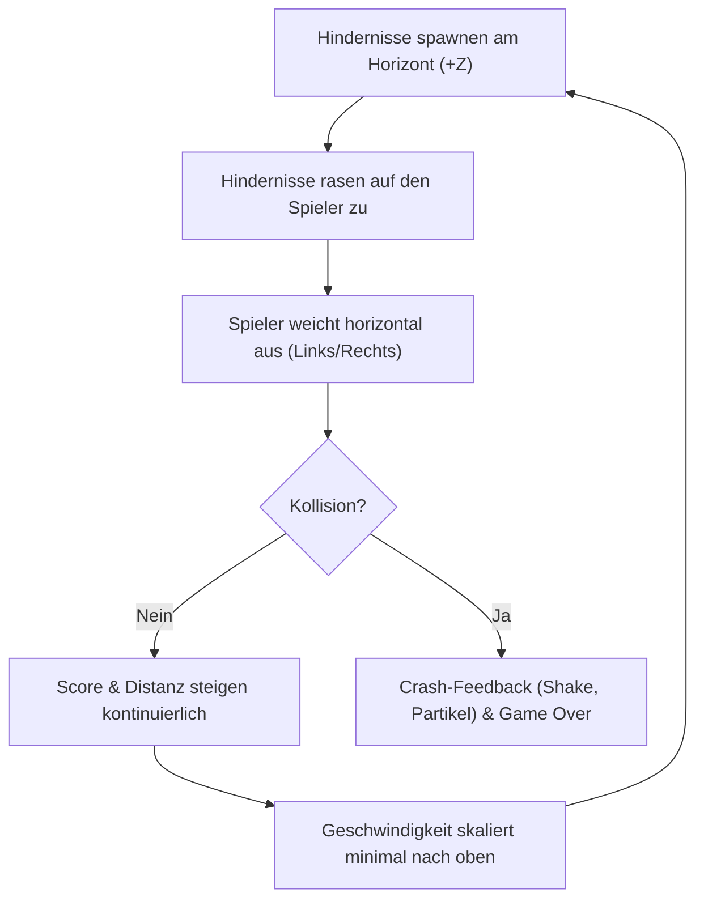

# 01 - High Concept & Core Gameplay Loop

## High Concept
**Neon Dodge** ist ein rasanter 3D-Endless-Dodger im Cyberpunk/Retro-Wave-Stil. Der Spieler steuert einen futuristischen Gleiter auf einem endlosen, neonbeleuchteten Highway und muss herannahenden Barrieren und Hindernissen mit hoher Reaktionsschnelligkeit ausweichen.

- **Genre:** 3D Arcade Endless Dodger
- **Plattform:** Web (Desktop & Mobile via WebGL/WebGPU)
- **Engine / Stack:** Babylon.js, TypeScript, Vite
- **Zielgruppe:** Studierende im Fach *Interaktive Grafikanwendungen (IGA)*

---

## Core Gameplay Loop (5–10 Sekunden)

1. **Beobachten:** Hindernisse erscheinen in der Ferne auf einer der Fahrspuren.
2. **Reagieren & Ausweichen:** Spieler steuert den Gleiter horizontal (`X`-Achse), um freie Lücken zu treffen.
3. **Belohnung:** Pro Sekunde Überleben und pro passierter Barriere steigt der Punktestand.
4. **Steigerung:** Die Geschwindigkeit der herannahenden Objekte nimmt mit zunehmender Spielzeit subtil zu.

---

## Win- & Loss-Bedingungen

* **Siegbedingung:** 
  - Als Endless-Arcade-Game gibt es kein narratives Spielende.
  - Das Ziel ist das Erreichen eines persönlichen oder lokalen **Highscores** (gespeichert in `localStorage`).
* **Verlustbedingung (Game Over):**
  - Jede Kollision des Spieler-Gleiters mit einem Hindernis beendet den aktuellen Lauf sofort (`Kollision -> GAME_OVER`).

---

## Scoring-Modell

Der Punktestand berechnet sich deterministisch aus zwei Faktoren:
1. **Passiv:** Grundpunkte für jede überlebte Sekunde ($10 \times \text{Sekunden}$).
2. **Aktiv (Near Miss Bonus):** Knappe Vorbeifahrten an Hindernissen verleihen Bonus-Punkte ($+50$).
3. **Multiplikator:** Mit jeder Minute ohne Kollision steigt der Multiplikator um $+0.5$ (z. B. $1.0\times \to 1.5\times \to 2.0\times$).
