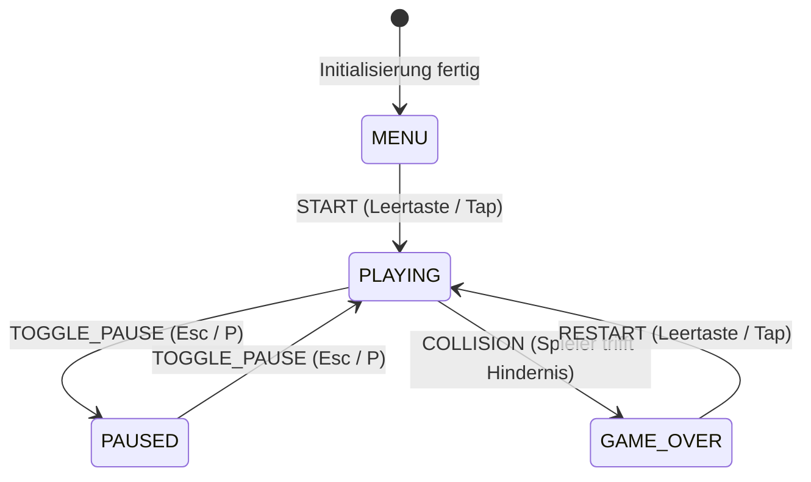

# 04 - Formale State Machine & Lebenszyklus

## Zustandsdiagramm

Das Spiel durchläuft vier eindeutig definierte Hauptzustände:



---

## Zustandsbeschreibungen & Übergänge

### 1. `MENU` (Startbildschirm)
- **Verhalten:**
  - Highway und Partikeleffekte laufen im Hintergrund als Attract-Mode.
  - Spieler-Gleiter schwebt sanft auf der Stelle (Idle-Bobbing).
  - Keine Hindernisse spawnen.
  - Overlay zeigt Titel „Neon Dodge“, Highscore und Aufforderung „Press Space / Tap to Start“.
- **Übergang zu `PLAYING`:**
  - Event: `START` (Trigger: Leertaste, Klick oder Touch-Tap).
  - Aktion: Punktestand auf 0 setzen, Spawner aktivieren, HUD einblenden.

### 2. `PLAYING` (Aktives Gameplay)
- **Verhalten:**
  - Delta-Time-gesteuerter Game Loop läuft.
  - Input-Handling für Links-/Rechts-Bewegung ist aktiv.
  - Spawner erzeugt Hindernisse am Horizont; Hindernisse bewegen sich auf die Kamera zu.
  - Score zählt kontinuierlich hoch.
  - Kollisionsprüfung zwischen Spieler-AABB und allen aktiven Hindernis-AABBs läuft pro Frame.
- **Übergang zu `PAUSED`:**
  - Event: `TOGGLE_PAUSE` (Trigger: Escape, `P`, Pause-Button).
  - Aktion: Game-Time einfrieren, Pause-Menü überblenden.
- **Übergang zu `GAME_OVER`:**
  - Event: `COLLISION` (Trigger: Spieler berührt ein Hindernis).
  - Aktion: Crash-Partikel zünden, Screen-Shake auslösen, Highscore prüfen und ggf. in `localStorage` speichern.

### 3. `PAUSED` (Pause)
- **Verhalten:**
  - Alle Positions- und Zeitaktualisierungen sind angehalten (`deltaTime = 0`).
  - Rendering der Szene bleibt aktiv (kein schwarzer Bildschirm).
  - Pause-Dialog sichtbar.
- **Übergang zu `PLAYING`:**
  - Event: `TOGGLE_PAUSE` $\implies$ Spiel setzt nahtlos an aktueller Position fort.

### 4. `GAME_OVER` (Spielende)
- **Verhalten:**
  - Gleiter stoppt bzw. wird unsichtbar / durch Explosionsfragmente ersetzt.
  - Verbleibende Hindernisse verlangsamen sich bis zum Stillstand.
  - Dialog zeigt:
    - Erzielten Score
    - Bisherigen Bestwert („NEW HIGHSCORE!“ falls übertroffen)
    - Replay-Button / Aufforderung „Press Space to Retry“.
- **Übergang zu `PLAYING`:**
  - Event: `RESTART` $\implies$ Alle Hindernisse despawnen, Spieler auf Startposition ($X=0$), Score auf 0 zurücksetzen.

---

## Softwaretechnische Umsetzung (Guard & Event Contract)

Im Code wird dieser Automat als typsichere Klasse/Funktion in `src/core/state.ts` realisiert:

```typescript
export type GameState = 'MENU' | 'PLAYING' | 'PAUSED' | 'GAME_OVER';

export type GameEvent = 'START' | 'TOGGLE_PAUSE' | 'COLLISION' | 'RESTART';
```

Ungültige Zustandsübergänge (z. B. `MENU` direkt nach `PAUSED`) werden programmatisch ignoriert oder werfen im Entwicklungsmodus einen Fehler.
